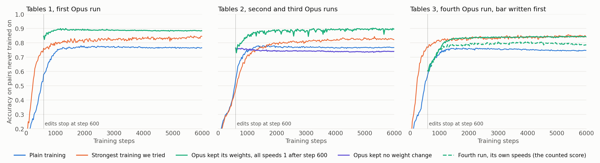
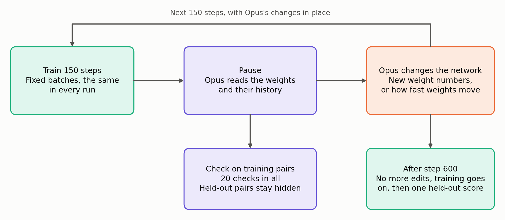
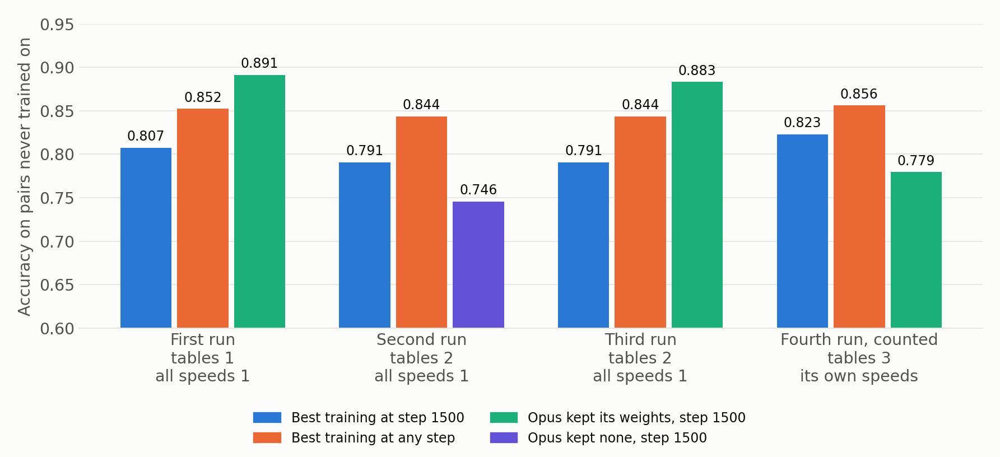

# Environment for researching how an LLM can edit neural network weights during training

> [!IMPORTANT]
> We are using this environment to write a paper for ICML 2027. It was built in [AI Research School](https://www.skool.com/become-ai-researcher-2669). The licence is MIT: you can use it for your own research without asking and without adding anyone as a co-author.

Training changes a network's weights a little at a time. This environment asks what happens when an LLM stops training, reads the weights, and writes new numbers into them by hand.

**An LLM (Claude Opus 5.5) lost the one test with a bar written first: it scored .779 at step 1500, against .823 for the best training at that step and .856 for the best training at any step.**

**Two of the three earlier runs kept hand-written weights and ended above all the training we tried, but we chose that comparison after seeing them, and it did not repeat. The LLM can sometimes work out what a half-trained network has learned and write it into the weights, and so far that does not reliably beat strong training.**

These are single runs on a toy network of 8,751 weights.



---

## Pause training, let the LLM change the weights, then let training go on



The network learns four skills. Each skill takes two numbers, **a** and **b**, and gives a class from 0 to 7. Each skill follows a hidden table, built from a sum, a product, a larger or smaller of two, or a difference, of two hidden per-number values.

Every 150 training steps up to step 600, the LLM may change the network. It can write **new weight numbers**, or set **speeds**, which multiply how far each weight moves per training step. It computes numbers with its own short Python, which may not use gradients or fit weights to a loss.

The LLM is never told the tables, never sees the training examples, and never sees **held-out pairs**, the 30% of (a, b) pairs the network does not train on. Accuracy on those pairs is read once, at the end. Every number below is that accuracy, averaged over the four skills.

---

## Results

### Do not expect a win when the edits stop: the LLM beat fixed speeds in 1 of 4 runs

The comparison is the best of 14 fixed speeds. Each multiplies every weight's step by one number, from step 0 or from step 150. The search for the first run ran after that run. The bar for the later runs was written before they started. The fourth run was told its goal was step 1500, not step 600.

| Step 600 | Plain training | Best fixed speed | Opus | Gain |
|---|---|---|---|---|
| First run, tables 1 | .579 | .803 | **.847** | +.044 |
| Second run, tables 2 | .542 | **.776** | .760 | -.016 |
| Third run, tables 2 | .542 | **.776** | .764 | -.012 |
| Fourth run, tables 3 | .576 | **.770** | .603 | -.167 |

> **At step 600 the first result did not repeat.**

### Do not count on a higher ceiling: kept hand-written weights ended above all training in 2 of 3 runs

Each finished run was trained further with no LLM. We then compared it with the strongest training we tried, 27 settings of learning rate, weight decay and dropout. We chose this comparison after seeing the first three runs, so those rows are a hypothesis, and the fourth run did not support it.

| Highest reading through step 6000 unless noted | Plain | Strongest training, same size | Opus, its own speeds | Opus, all speeds 1 |
|---|---|---|---|---|
| First run | .779 | .852 (step 10800) | **.901** | .899 |
| Second run, no weight change kept | .781 | **.844** | .760 | .762 |
| Third run | .781 | .844 | .864 | **.902** |
| Fourth run | .763 | **.856** | .806 | .846 |

> **Training here is cheap: 6000 steps take about 4 seconds, and one LLM reply takes far longer. The result is about where the network ends up, not about saved time.**

### Do not freeze neurons for a skill the LLM cannot read

In the third run Opus read three skills correctly, wrote weights for them and froze them. It could not read the fourth, which then had few neurons to train on.

| Third run, step 600 | Opus | Best of 24 training controls | Gap |
|---|---|---|---|
| Smaller of two values | .925 | .997 | -.072 |
| Sum | **.919** | .802 | +.117 |
| Difference | .338 | .63 | -.292 |
| Product | **.873** | .795 | +.078 |

> **Writing weights won on the skills it read and lost more than that on the one it did not.**

### Do not trust the earlier wins: the fourth run lost to a bar written first

The fourth run used new hidden tables and allowed 30 replies, of which Opus used 13. The goal told to the editor was accuracy at step 1500. Every baseline, the bar and our prediction were recorded before it started.

| Bar, mean at step 1500 | Opus beats it | Tie | Opus loses | Opus scored |
|---|---|---|---|---|
| Strongest training at any step, .856 | above .886 | .826 to .886 | below .826 | **.779, loses** |
| Best training at step 1500, .823 | above .853 | .793 to .853 | below .793 | **.779, loses** |

Our prediction was a mean of .82 to .90, most likely about .86, so **the prediction was wrong**.



Opus worked out one rule exactly, the larger of two hidden values. It wrote that rule into 8 neurons, which then scored 1.000 on held-out pairs. The best training also reaches 1.000 on that skill by step 1500, so writing it gained nothing there. Opus guessed the wrong form for the product and sum skills, and never identified the difference skill.

| Step 1500, held-out | Difference | Larger | Product | Sum | Mean |
|---|---|---|---|---|---|
| Plain training | .519 | .981 | .802 | .724 | .756 |
| Best training at step 1500 | .662 | 1.000 | **.854** | .776 | **.823** |
| Opus, its own speeds (counted) | **.705** | 1.000 | .734 | .679 | .779 |
| Same weights, all speeds 1 (post hoc) | .672 | 1.000 | .841 | **.789** | .826 |

> **The skill Opus could not read scored above training on its own neurons, by .043. Its last speed settings cost .047 on the mean, and edits stop at step 600, so it could not correct them.**

---

## Where it stops working

> [!WARNING]
> - **One run per setting** on a toy with 8,751 weights. Nothing here has been tried on a language model. Neighbouring fixed speeds differ by up to .03.
> - **The task family suits hand-writing.** Every table is built from two hidden per-number values, a shape the LLM can guess. Tasks with no such shape may give nothing.
> - **The step 1500 and step 6000 comparisons are post hoc** for the first three runs. Only the fourth run's step 1500 score was tested against a bar written first, and that is one run. The strongest training row was read on held-out pairs, which favours training.
> - **The fourth run had one relay error.** One number sent to the editor was mistyped and corrected in the next message. See [RESULTS.md](RESULTS.md#relay-errors).
> - **The LLM's short Python does real work.** It reads the network's predictions and calculates the weights. It uses no gradients and no labels, but it does use CPU.
> - **Nobody outside has reviewed this.** Claude Opus 5.5 built the environment, ran the runs and wrote this text. A separate fresh Opus plays each editor.

---

## Is this new?

Searches did not settle this. We found no work where an LLM edits weights during training, and no comparison of hand-written and trained weights on held-out data like this one.

| Work | LLM writes weights | During training | Compared with |
|---|---|---|---|
| [Sparks of Weight-Space Programming](https://rikiyat.github.io/blog/weight-space-programming/) (Takehi et al., 2026, blog post) | Yes | No, finished or new networks | Trained networks, base models |
| [ACDC](https://arxiv.org/abs/2304.14997) (Conmy et al., 2023) | No, finds circuits automatically | No | Other circuit methods |
| [Weight-sparse transformers](https://arxiv.org/abs/2511.13653) (2025) | No | No | Dense networks |
| This repository | Yes | **Yes** | **27 training settings, 14 fixed speeds** |

The Sparks post is the starting point. It reports an LLM writing a Breakout policy that beats a network trained with PPO, and editing a small language model to raise its MATH-500 score from 7.9% to 48.1%. It does not report edits during training or a comparison with further training.

---

## Setup

```bash
pip install -r requirements.txt
```
```bash
python3 -m venv toy/.kernel && toy/.kernel/bin/pip install numpy scipy
```
```bash
cd toy && TOY_RULES=secret python3 loop.py test
```

The sandbox for the LLM's Python runs on macOS. The Linux path exists and has not been tested. To run an editor, and for every number and command, see [RESULTS.md](RESULTS.md).

- [RESULTS.md](RESULTS.md): every table, the commands and how to play an editor.
- [NOTES.md](NOTES.md): the working log, with the bars and predictions written before each run, including the ones that failed.
- [language-model/](language-model/README.md): a second bench for repairing planted defects in a small language model. It has no counted LLM result yet.
- [chart.py](chart.py) draws every image from the result files.
