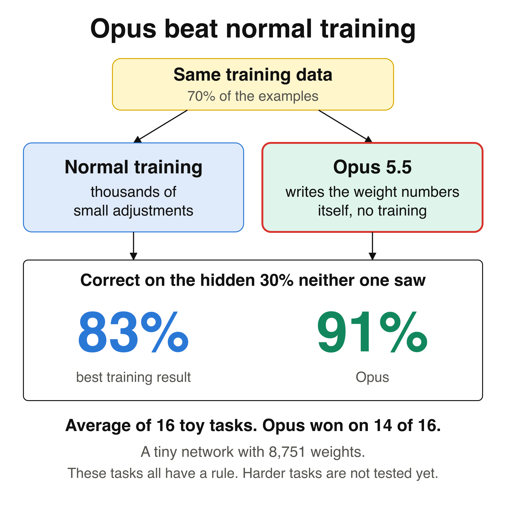
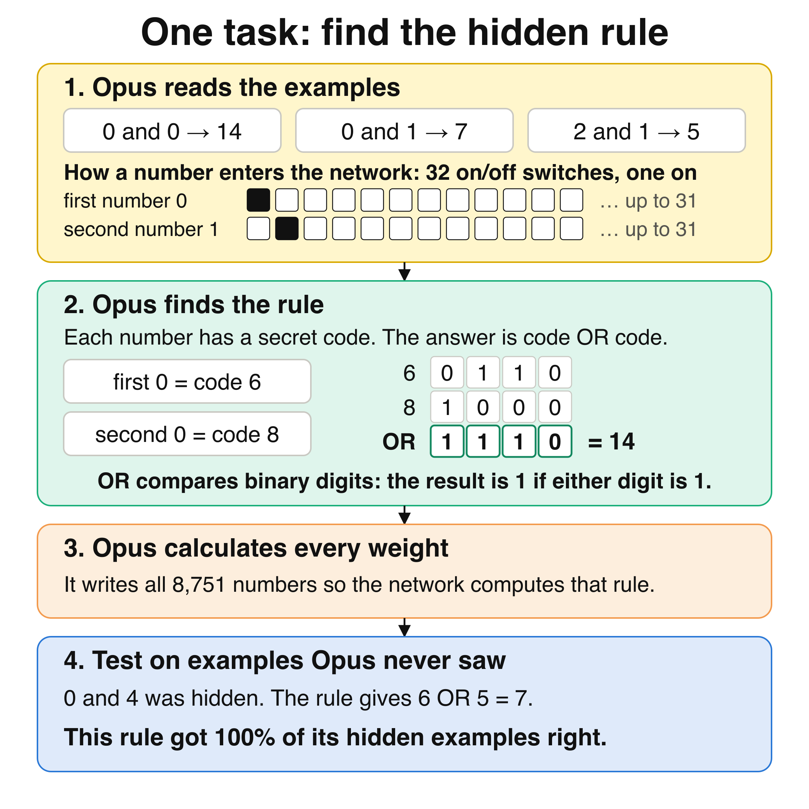
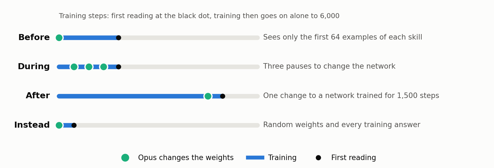
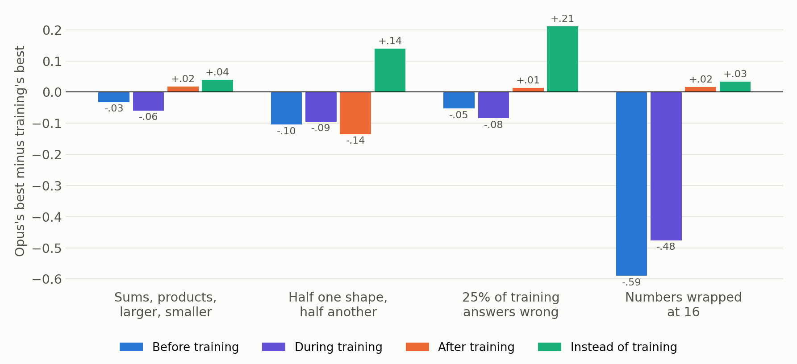
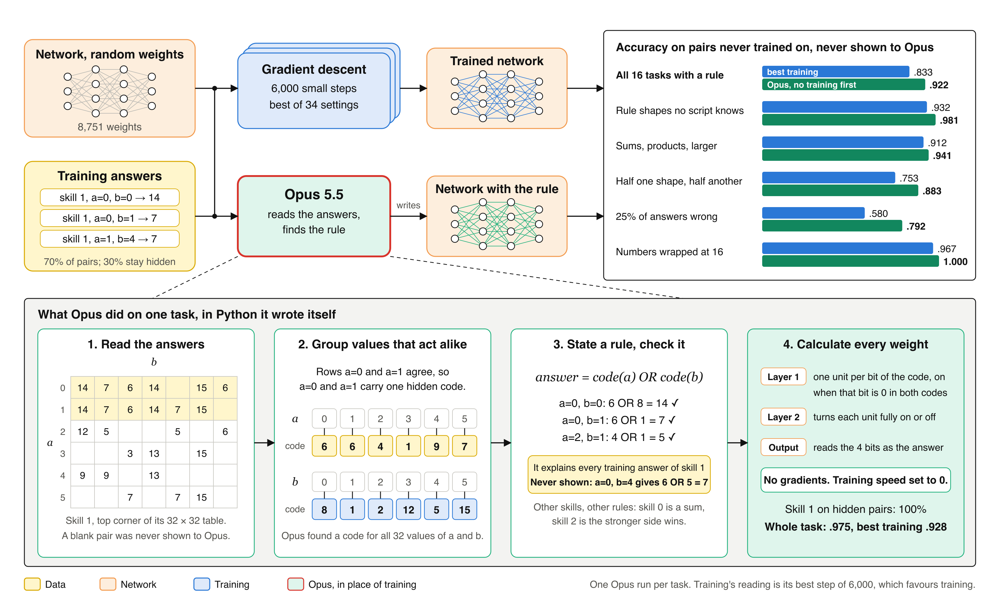
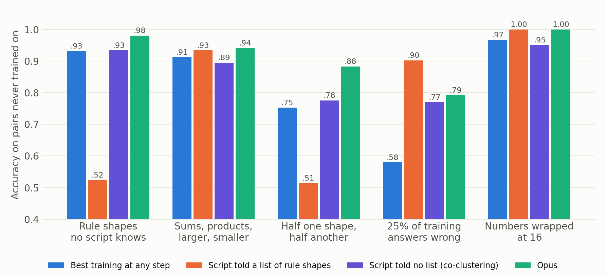

# Environment for researching how an LLM can replace or augment training by writing network weights

> [!IMPORTANT]
> **Given every training answer and no training at all, Claude Opus 5.5 wrote weights that scored higher on unseen inputs than the best of 34 training settings at any step, on 14 of the 16 tasks that have a rule: mean +.080 (standard error .023). It lost the other two by .029 and .003.**
>
> Changing weights before or during training lost on all 4 kinds of task. Changing them after training helped at that step on 4 of 5 kinds, and the lead at the best reading was .02 or less. On 2 random tables with no rule, Opus said it found no rule.

We are using this environment to write a paper for ICML 2027. It was built in [AI Research School](https://www.skool.com/become-ai-researcher-2669). The licence is MIT: you can use it for your own research without asking and without adding anyone as a co-author.



### The task: find a hidden rule from examples

A small neural network gets two numbers and must give the answer that a hidden rule assigns to them. For example, 0 and 0 give 14, and 0 and 1 give 7.

Each number enters the network as 32 on/off switches with one switch on, so the network is not told that the numbers have any order. 70% of the pairs are for training, and the other 30% are kept hidden for validation.

In the example below, each number has a secret code, and the answer is the two codes combined with OR, which compares binary digits and gives 1 if either digit is 1. Other tasks use other rules.

### What Opus did

First we trained the network normally and kept the best score from 34 training settings at any step, which favours training. Then Claude Opus 5.5 read the same training data and wrote all 8,751 weights as literal numbers, with no training at all.

Opus found the rule and calculated weights that compute it. These scores are the weights exactly as Opus wrote them, on the hidden pairs, with no training step after them.



### The result on hidden pairs

| Tasks | Normal training | Opus 5.5 |
|---|---:|---:|
| 16 tasks with a rule | 83.3% | **91.3%** |
| 3 of those, with 25% of training answers made wrong | 58.0% | **76.3%** |
| 2 random tables with no rule (not in the 16) | **15.3%** | 12.6% |

Opus won on 14 of the 16 tasks with a rule, by +.080 on average (standard error .023). It lost one task by .029 and one by .003, both among sums, products, larger and smaller, where the mean over 3 tasks ties at .912. With 25% wrong answers, the hidden pairs keep their correct answers, so Opus recovered most of the rule despite the errors.

One harder test so far used real handwritten digits, and Opus's written weights came within .006 of training on it. [The section below](#on-real-handwritten-digits-opuss-written-weights-came-within-006-of-best-training) has the numbers.

> **What this is, and what it is not.** Opus works out a rule from the answers, then stores that rule as weight numbers. That is program synthesis with a network as the storage, so the network itself is not what generalises. These are single runs on a toy network of 8,751 weights.

---

## Stop training, let the LLM write the weight numbers, and find out when that helps

Training moves every weight a little at a time, using gradients. An LLM can do something different: read what the network must do, work out a rule, and calculate the weight numbers that carry that rule out.

We asked where this helps. Fresh Opus runs got one of four chances, and training then went on alone to step 6,000:



The network learns four **skills**. Each skill takes two numbers, a and b, and gives one of 8 classes by a hidden rule. **Held-out pairs**, 30% of all (a, b) pairs, are never trained on and never shown to Opus. The score is accuracy on those pairs.

Opus may write short Python to calculate its numbers, but no gradients and no iterative fitting of weights to a loss. **Best training** is the best of 34 settings of learning rate, weight decay, dropout, fixed speeds and published edits such as weight averaging. Its best step is picked on held-out pairs, which favours training. A pass rule and numeric predictions were pushed before each counted test, and failed predictions stay in [NOTES.md](NOTES.md).

---

## Results



### Do not change weights before or during training: Opus lost on all 4 kinds of task

Before training it saw only 64 examples per skill. During training it had three pauses in the first 600 steps. It lost by .03 to .59 against training's best, which kept rising past what Opus wrote. This is one task per setting, so it shows direction and not size.

### Change weights after training for a quick jump, and expect a small lead at the end

Opus changed a network once, after 1,500 steps of training. The first number compares both at step 1,650. The second compares each one's best reading through step 6,000.

| Kind of task | Tasks | Gain at step 1,650 | Gain at the best reading | Rule |
|---|---:|---:|---:|---|
| Numbers wrapped at 16 | 6 | **+.237** | +.016 | Passed |
| Rule shapes no script knows | 5 | **+.065** | -.009 | Passed |
| 25% of training answers wrong | 6 | **+.038** | +.014 | Passed by .00005 |
| Sums, products, larger, smaller | 6 | **+.037** | +.018 | Failed: +.026 on new tasks |
| Half one shape, half another | 1 | -.076 | -.135 | Failed |

> **After training, Opus jumps ahead at that step. Training never reached Opus's first reading on 14 of 24 tasks, but the mean gap at the best reading stayed under .02.**

### Replace training when you hold the answers and they follow a rule



Opus got random weights and every training answer. It never saw the network train, because no training ran before its change. It worked out a rule and wrote the weights. The test then ran 150 steps at speeds it chose, and it set every speed to 0 on 7 of 18 tasks. So the table gives both scores: the weights as written, and after those 150 steps.

| Kind of task | Tasks | Opus, no training | Opus, after 150 steps at its speeds | Best training at any step |
|---|---:|---:|---:|---:|
| Rule shapes no script knows | 5 | **.981** | .981 | .932 |
| Sums, products, larger, smaller | 3 | .912 | .941 | .912 |
| Half one shape, half another | 3 | **.892** | .883 | .753 |
| 25% of training answers wrong | 3 | **.763** | .792 | .580 |
| Numbers wrapped at 16 | 2 | **1.000** | 1.000 | .967 |
| Random tables, no rule | 2 | .126 | .123 | .153 |

> **With no training, Opus was above best training on 14 of 16 tasks with a rule. After its 150 steps it was above on all 16 and passed the written rule on all 5 kinds.** Its gains were largest where training suffers most: mixed rules and wrong answers.

### Use a plain script when you know the possible rule shapes, and an LLM when you do not

Two scripts got the same answers. One tries a fixed list of rule shapes that we wrote. The other, **co-clustering**, gets no list: it groups rows and columns of the answer table that behave alike.



> **The list script scored .902 against Opus's .763 when 25% of the answers were wrong, because its list contained the right shapes. Outside its list it scored .52, against Opus's .98.** Opus, with no training, beat co-clustering on 14 of 16 tasks, and co-clustering was slightly ahead on the 25% wrong tasks, .770 against .763. It is one quick rival, and a stronger synthesis method might match Opus.

### Do not read a rule unless the task has one

On both random tables, Opus reported no rule, silenced unused outputs, and scored within .03 of best training. Two tasks are a small test of this.

### If the answers are gone, read the rule out of the trained network

Without the answers, a script tried its rule list on a trained network's predictions. The rule scored above the network it came from on 15 of 15 tasks: 1.000 vs .956 for wrapped numbers, .930 vs .887 for tables and .718 vs .595 with 25% wrong answers. On rule shapes outside any list, Opus reading a trained network scored +.095 above co-clustering on the same network, above on 4 of 5. [RESULTS.md](RESULTS.md) has the tables.

---

## On real handwritten digits, Opus's written weights came within .006 of best training

The tasks above are built from a hidden rule. Handwritten digits have no short rule, so we tested them too: 1,797 images of 8 by 8 pixels, 10 digits, 70% to work from and 30% hidden. The network has 5,962 weights. Opus changed the weights once, and the score below is those weights as written, with no training.

| Method | Correct on hidden images |
|---|---|
| **Opus's written weights, no training** | **.970** |
| Same statistics method as plain code, no network | .974 |
| Best training, best of 24 settings at its best step | .976 |
| Support vector machine, default settings | .976 |
| 1 nearest neighbour | .985 |

Opus computed one straight separating line for each pair of digits, 45 lines, from the average image of each digit and how pixels vary together. This method is called one-vs-one linear discriminant analysis. It stored those lines in the first layer and used the later layers to add up the votes.

> **Before the run we predicted .90 to .96, losing to training by at least .02. That prediction was wrong.** This is one task on one split, and this dataset is easy. Opus used a known statistics method, and the same method as plain code scored .004 higher.

---

## Where it stops working

> [!WARNING]
> - **One Opus run per task, on a toy.** The network has 8,751 weights. Nothing here has been tried on a language model. The only natural data so far is one split of small handwritten digits.
> - **Every task with a rule is two-part by construction.** Each answer depends on hidden values of a and b. Handwritten digits have no short rule, and there Opus used a known statistics method without beating training or that method as plain code.
> - **Opus's short code does real work.** Some runs used repeated discrete searches, vote passes, one-pass least squares or SVD over the answers. These touch no weights against a loss. They were disclosed and not voided, and each run's code is in its ledger.
> - **The search grew as results came in.** We screened 13 settings first and added modes after seeing them. Each later rule was pushed before its test, on tasks not used before. Peak readings of Opus and training are both picked on held-out pairs.
> - **Opus editors may have received general context about earlier results.** Each ran as a fresh agent, and its transcript was audited for any tool use beyond the bench. A fresh Opus is not an independent lab.
> - **Nobody outside has reviewed this.** Claude Opus 5.5 built the environment, ran the runs and wrote this text.

---

## Is this new?

Not as a kind of result. Rules extracted from networks have beaten those networks before, and our three searches do not settle the question.

| Work | What finds the rule | Written back as weights | Compared with training on unseen data |
|---|---|---|---|
| TREPAN (Craven and Shavlik, 1996) | Decision tree from a network's answers | No | Yes, against the network |
| [REFNE](https://lamda.nju.edu.cn/publication/aicom03.pdf) (Zhou, Jiang and Chen, 2003) | Rule search on an ensemble's answers | No | Yes, rules can win |
| KBANN (Towell and Shavlik, 1994) | A person writes the rules | **Yes**, then trains | Yes |
| [Doshi et al., 2023](https://arxiv.org/abs/2310.13061) | A regularised network, on corrupted modular labels | No | Recovers the clean rule |
| [Sparks of Weight-Space Programming](https://rikiyat.github.io/blog/weight-space-programming/) (2026) | An LLM | **Yes**, finished or new networks | Trained networks, base models |
| This repository | An LLM, with no list of shapes | **Yes** | **34 settings, at four timings, with a rule written first** |

The new part is narrow: this comparison of timings, with an LLM as the editor, and a rule written before each test.

---

## Setup

```bash
pip install -r requirements.txt
```
```bash
python3 -m venv toy/.kernel && toy/.kernel/bin/pip install numpy scipy
```
```bash
cd toy && python3 search.py test
```

The sandbox for the LLM's Python runs on macOS. The Linux path exists and has not been tested.

- [RESULTS.md](RESULTS.md): every table, the reviewer objections, the commands and how to play an editor.
- [NOTES.md](NOTES.md): the working log, with every rule and prediction written before each test.
- [toy/search_runs/](toy/search_runs/): each of the 51 Opus runs, with its code, outputs and audit.
- [language-model/](language-model/README.md): a second bench for repairing planted defects in a small language model. It has no counted LLM result yet.
- [chart.py](chart.py) draws every image from the result files.
