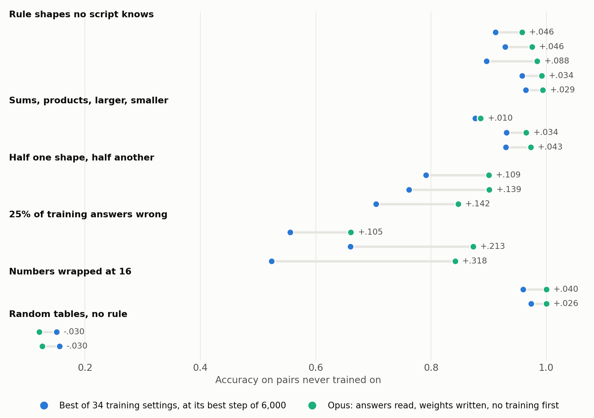
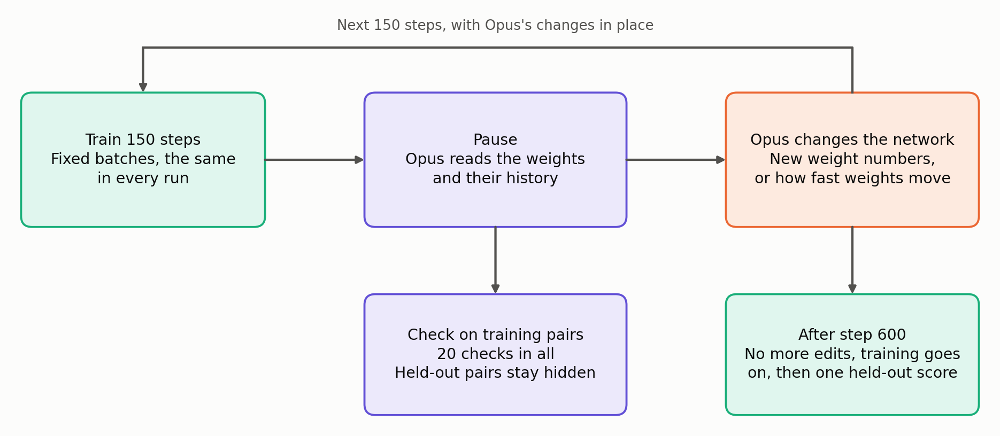
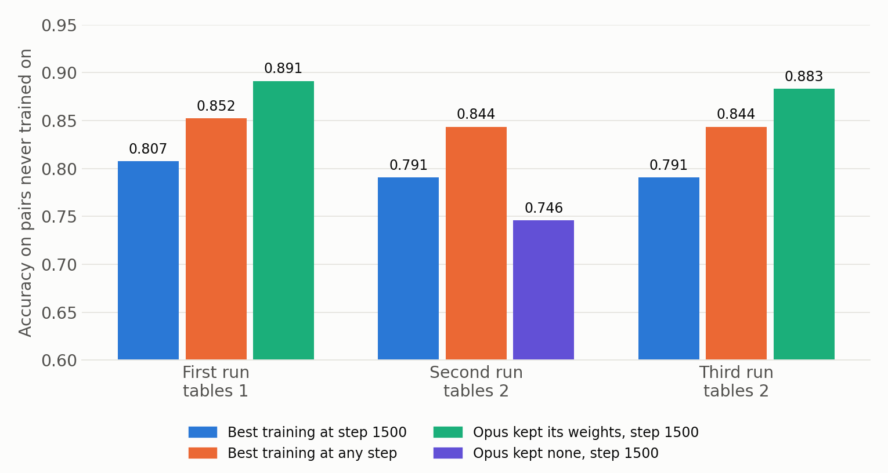

# Results

Every number is accuracy on held-out pairs, the 30% of (a, b) pairs the network never trains on. Means are over the four skills. There is one run per setting. The search's result rows are in `toy/search_runs/*.jsonl`. The first four runs' rows are in `toy/results_secret*.jsonl`, `toy/steps_saved.jsonl` and `toy/tuned.jsonl`.

## The toy

A network with 68 inputs (a from 0 to 31, b from 0 to 31, and one of 4 skills, each one-hot), two hidden layers of 48 neurons with SiLU, and 63 outputs read as a class. It has 8,751 weights and 96 hidden neurons. Batches are fixed in advance whatever the editor does, so two runs differ only by the edits.

Each skill gives every number its own hidden random values, f(a) and h(b), and cuts the result of one form into 8 equal classes. The editor is told none of this.

| Tables | Skill 0 | Skill 1 | Skill 2 | Skill 3 |
|---|---|---|---|---|
| 1 | f + h | f × h | larger | difference |
| 2 | smaller | f + h | difference | f × h |
| 3 | difference | larger | f × h | f + h |

The editor gets up to 12 or 30 replies, 5 Python blocks per reply at 20 CPU seconds each, and 20 checks on training pairs. Gradients and iterative fitting are not allowed, and code that looks like them is flagged in the ledger.

## Step 600, per skill

| Tables 1 | Skill 0 | Skill 1 | Skill 2 | Skill 3 | Mean |
|---|---|---|---|---|---|
| Plain training | .497 | .643 | .971 | .205 | .579 |
| Best fixed speed, x5 from step 0 | .795 | .847 | .968 | .604 | .803 |
| **First Opus run** | .899 | .948 | 1.000 | .539 | **.847** |

| Tables 2 | Skill 0 | Skill 1 | Skill 2 | Skill 3 | Mean |
|---|---|---|---|---|---|
| Plain training | .974 | .471 | .205 | .519 | .542 |
| **Best fixed speed, x7 from step 0** | .964 | .802 | .568 | .769 | **.776** |
| Plain training to step 1800 | .974 | .763 | .558 | .795 | .772 |
| Second Opus run, no weight change kept | .974 | .753 | .542 | .773 | .760 |
| Third Opus run | .925 | .919 | .338 | .873 | .764 |

| Tables 3 | Skill 0 | Skill 1 | Skill 2 | Skill 3 | Mean |
|---|---|---|---|---|---|
| Plain training | .195 | .964 | .630 | .513 | .576 |
| Best fixed speed, x5 from step 0 | .539 | .974 | .805 | .763 | .770 |
| Plain training to step 1800 | .529 | .971 | .802 | .750 | .763 |
| Plain training to step 3000 | .542 | .974 | .792 | .724 | .758 |
| Fourth Opus run | .205 | 1.000 | .627 | .581 | .603 |

## What each part of the first run was worth

It kept hand-written weights on about a quarter of the neurons, and its own speed map, from step 450. Replaying it from the ledger gives the same weights and score.

| Setting | Mean |
|---|---|
| Speed x2 from 150, no weight change | .723 |
| Speed x2 then x2.5, no weight change | .737 |
| Its weights, no more training | .717 |
| Its weights, its frozen parts, speed 1 on the rest | .803 |
| Its weights, speed 1 everywhere | .807 |
| Its weights and its speed map (the real run) | .847 |

## After step 600

Written after seeing the first three runs, so it is post hoc. The exception is the fourth run's own speeds at step 1500, which is the score counted against the written bar.

| Network | Step 600 | Step 1500 | Step 6000 | Peak |
|---|---|---|---|---|
| Tables 1, plain | .579 | .764 | .764 | .779 |
| Tables 1, fixed x5 | .803 | .794 | .795 | .804 |
| Tables 1, first run, its speeds | .847 | .895 | .895 | .901 |
| Tables 1, first run, speed 1 | .847 | .891 | .884 | .899 |
| Tables 2, plain | .542 | .773 | .767 | .781 |
| Tables 2, fixed x7 | .776 | .777 | .768 | .783 |
| Tables 2, second run, speed 1 | .760 | .746 | .740 | .762 |
| Tables 2, third run, its speeds | .764 | .858 | .860 | .864 |
| Tables 2, third run, speed 1 | .764 | .883 | .896 | .902 |
| Tables 3, plain | .576 | .756 | .746 | .763 |
| Tables 3, fixed x5 | .770 | .759 | .744 | .774 |
| Tables 3, fourth run, its speeds (counted at step 1500) | .603 | **.779** | .786 | .806 |
| Tables 3, fourth run, speed 1 | .603 | .826 | .841 | .846 |

The third run's own speeds keep its hand-written neurons frozen and it does worse than speed 1, which lets them train.

## The fourth run against its written bar

Run `secret3-1`, tables 3, `TOY_FINISH=1500`. It used 13 of 30 replies and 10 of 20 checks. The bar and prediction were written before it started, and are in [NOTES.md](NOTES.md).

| Bar on the mean at step 1500 | Beats | Tie | Loses | Result |
|---|---|---|---|---|
| Strongest training at any step, .856 | above .886 | .826 to .886 | below .826 | .779, loses |
| Best training at step 1500, .823 | above .853 | .793 to .853 | below .793 | .779, loses |

Prediction: mean .82 to .90, most likely about .86. That was wrong. The second part of the prediction, that it keeps hand-written weights on at least one skill, held.

| Step 1500 | Difference | Larger | Product | Sum | Mean |
|---|---|---|---|---|---|
| Plain training | .519 | .981 | .802 | .724 | .756 |
| Best training at step 1500: dropout .1, lr .01, weight decay .1 | .662 | 1.000 | .854 | .776 | .823 |
| Opus, its own speeds (counted) | .705 | 1.000 | .734 | .679 | .779 |
| Same weights, all speeds 1 (post hoc) | .672 | 1.000 | .841 | .789 | .826 |

What Opus did, from its ledger: at step 300 it rebuilt the network from its step 50 weights. It wrote `max(u(a), v(b))` into 8 neurons for the larger skill and froze their gates. At step 450 it gave the product and sum skills 8 neurons each, seeded from their row and column effects, with code weights at speed 10. It gave the difference skill the other 24 neurons at speed 3. In its last message it named the risk of those speeds, and said it had inferred the form "smaller" for the product and sum skills without testing it. That inference was wrong.

The ledger has one flag, "reply 11: word match". The match is the word "fit" in printed labels such as "max model fit". That code tabulates predictions and fits nothing.

## Strongest training

27 settings of learning rate, weight decay, dropout and width, read every 25 steps to step 6000, and some to 15000. The best row is read on held-out pairs, which favours training.

| Tables | Best at same size, any step | Setting | Best at step 1500 | Best at any size |
|---|---|---|---|---|
| 1 | .852 at step 10800 | dropout .1 | .807 | .864, width 192, dropout .1 |
| 2 | .844 at step 5325 | dropout .1 | .791 | |
| 3 | .856 at step 5375 | dropout .1, lr .01, weight decay .1 | .823 | |

## Search: before, during or after training, on five kinds of task

The rule and predictions were published before the first counted run. They are in [NOTES.md](NOTES.md), under "Search: where can Opus's weight changes help?". The code is [toy/search.py](toy/search.py). Every run, its transcript of replies and its result are in [toy/search_runs](toy/search_runs).

### First round: changing weights after training passed on 3 of 4 kinds of task, before and during passed on none

A fresh Opus 5.5 worked on each setting once. Each setting is compared with the best of 34 controls on that task: 15 learning rate and weight decay settings, 4 dropout settings, 5 fixed speeds, and the published edits for that timing (weight averaging, shrink and perturb, reset quiet neurons, straight line, scaled starting weights). We read the best control on held-out pairs, which favours training.

The first number is the **first-reading gain**: Opus minus the best control at the same step. The second is the **peak gain**: Opus's best through step 6000 minus the best control at any step from the first reading on. A setting passes if either is at least +.03.

| Kind of task | Before training | During training | After training |
|---|---|---|---|
| Tables: sum, product, larger, smaller, difference of hidden values | -.032 / -.032 | -.009 / -.059 | **+.093 / +.071** |
| Conditions: half of a follows one shape, half another | -.022 / -.104 | -.057 / -.095 | -.076 / -.135 |
| Partly wrong: tables with 25% of training answers wrong | -.013 / -.053 | -.030 / -.084 | **+.080 / +.041** |
| Modular: hidden values wrapped at 16 | -.276 / -.589 | -.176 / -.476 | **+.147** / -.069 |

The leak check has no rule to find, so it should show no gain. It gave -.016 / -.025 during training, inside the limit of +.05.

| Run | Setting | Opus | Best control, same step | Opus peak | Best control, any later step | Replies | EVALs | Tokens |
|---|---|---:|---:|---:|---:|---:|---:|---:|
| r01 | conditions, after | .523 | .599 | .537 | .673 | 8 | 3 | 95,615 |
| r02 | random, during | .128 | .144 | .135 | .160 | 14 | 11 | 115,157 |
| r03 | partly wrong, after | **.675** | .595 | **.675** | .635 | 14 | 13 | 144,113 |
| r04 | partly wrong, before | .567 | .580 | .582 | .635 | 5 | 1 | 88,926 |
| r05 | partly wrong, during | .550 | .580 | .550 | .635 | 13 | 6 | 107,137 |
| r06 | conditions, during | .505 | .562 | .578 | .673 | 11 | 3 | 106,807 |
| r07 | tables, before | .777 | .809 | .828 | .860 | 9 | 3 | 124,665 |
| r08 | modular, before | .128 | .404 | .357 | .947 | 7 | 1 | 85,373 |
| r09 | conditions, before | .540 | .562 | .568 | .673 | 10 | 1 | 110,022 |
| r10 | modular, during | .228 | .404 | .471 | .947 | 13 | 2 | 119,347 |
| r11 | modular, after | **.878** | .731 | .878 | .947 | 15 | 9 | 144,401 |
| r12 | tables, after | **.911** | .818 | **.930** | .860 | 13 | 6 | 129,284 |
| r13 | tables, during | .800 | .809 | .800 | .860 | 14 | 3 | 131,047 |

Things to know before reading these:

- **r01's last code block crashed** because the bench had not made its speed folder, so its planned speeds were not set. The folder was added for later runs, and r01 stands as scored.
- **Three runs came close to the ban on iterative fitting.** r03 kept two rounds of alternating majority votes over the network's own outputs. r12 used alternating scans as a diagnostic and dropped them from the weights. r11 also read rules from the table. None used labels or gradients. Scripted word flags on r09 and r11 are listed in [toy/search_runs/results.jsonl](toy/search_runs/results.jsonl).
- **The first prediction was wrong in places.** It said modular would lose by .20 or more everywhere, and modular after is the largest gain.

### Harder comparison for wrong answers: training methods built for wrong labels cut the lead from +.080 to +.039

We added these 14 runs after r03 passed, because a reviewer would ask for them: label smoothing, generalized cross entropy, bootstrapping, forward correction told the true noise rate, 8 outputs only, and mixup, each at two settings. The code is [toy/robust.py](toy/robust.py).

| Partly wrong, first task | At step 1650 | Best at any later step |
|---|---:|---:|
| Best of the 34 controls | .595 | .635 |
| Best method built for wrong labels | .636 | **.677** |
| Opus, r03 | **.675** | .675 |

> **What is left of r03's lead is speed: about the same accuracy roughly 1,400 steps sooner.** r03 wrote two skills exactly (1.000 and 1.000), and was no better on the other two.

### Later rounds: what held up

Each round had a rule and predictions pushed first, on new tasks. Stage 1 is the table above. Per-task numbers and each prediction's outcome are in [NOTES.md](NOTES.md).

All readings below use the same comparison: first reading gain is Opus minus the best control at that step, and best reading gain is Opus's best through step 6,000 minus the best control at any step from its first reading on.

| Timing | Kind of task | Tasks | First reading gain | Above zero | Best reading gain | Above zero |
|---|---|---:|---:|---:|---:|---:|
| Before | Tables, two shapes, 25% wrong, wrapped | 1 each | -.032, -.022, -.013, -.276 | 0 of 4 | -.032, -.104, -.053, -.589 | 0 of 4 |
| During | Tables, two shapes, 25% wrong, wrapped | 1 each | -.009, -.057, -.030, -.176 | 0 of 4 | -.059, -.095, -.084, -.476 | 0 of 4 |
| After | Tables | 6 | +.037 | 5 | +.018 | 3 |
| After | Two shapes | 1 | -.076 | 0 | -.135 | 0 |
| After | 25% wrong | 6 | +.038 | 5 | +.014 | 4 |
| After | Wrapped | 6 | +.237 | 6 | +.016 | 5 |
| After | Rule shapes no script knows | 5 | +.065 | 4 | -.009 | 3 |

Across these 24 after-training tasks, training never reached Opus's first reading on 14. The two-shape task lost at both readings.

A plain script with a list of rule shapes then ran on tasks 6-10, with no LLM. Reading the trained networks, it scored .984 for wrapped numbers, .899 for tables and .714 with 25% wrong answers. Run on the answers instead, it scored 1.000, .908 and .901, above the network script on 14 of 15 tasks.

### Without any training: Opus given every training answer



> [!WARNING]
> **Correction, 2026-11-03.** An earlier version of this page and the README called the first reading "no training". In this test 150 steps ran after Opus's edit at speeds it chose, and it left some speeds above 0 on 11 of 18 tasks. `toy/no_training.py` replays each run's logged code and reads held-out pairs straight after the edit. The table below is that score. With no training at all the 16 tasks with a rule give .913 against .833, mean +.080, standard error .023, above best training on 14 of 16. The table further down keeps the first readings, which are .922 and +.089 after the 150 steps.

| Run | Kind | Task | Largest mean speed on a tensor | Opus, no training | Opus first, after 150 steps | Best training, any step | Gain with no training |
|---|---|---:|---:|---:|---:|---:|---:|
| r34 | Rule shapes no script knows | 0 | .020 | .958 | .958 | .912 | +.046 |
| r35 | Rule shapes no script knows | 1 | 0 | .975 | .975 | .928 | +.046 |
| r36 | Rule shapes no script knows | 2 | 0 | .984 | .984 | .896 | +.088 |
| r37 | Rule shapes no script knows | 3 | 0 | .992 | .992 | .958 | +.034 |
| r38 | Rule shapes no script knows | 4 | 0 | .994 | .994 | .965 | +.029 |
| r39 | Tables | 16 | 1.275 | .847 | .886 | .876 | -.029 |
| r42 | Tables | 17 | .078 | .964 | .965 | .931 | +.033 |
| r45 | Tables | 18 | .875 | .926 | .973 | .929 | -.003 |
| r40 | Two shapes | 16 | 0 | .900 | .900 | .791 | +.109 |
| r43 | Two shapes | 17 | .523 | .897 | .901 | .762 | +.135 |
| r46 | Two shapes | 18 | 1.000 | .878 | .847 | .705 | +.173 |
| r41 | 25% wrong | 16 | .708 | .568 | .661 | .556 | +.012 |
| r44 | 25% wrong | 17 | .249 | .873 | .873 | .660 | +.213 |
| r47 | 25% wrong | 18 | .007 | .849 | .842 | .524 | +.325 |
| r48 | Wrapped | 16 | 0 | 1.000 | 1.000 | .960 | +.040 |
| r49 | Wrapped | 17 | 0 | 1.000 | 1.000 | .974 | +.026 |
| r50 | Random | 16 | .127 | .123 | .121 | .151 | -.028 |
| r51 | Random | 17 | .127 | .128 | .126 | .156 | -.028 |

The replay reproduced the recorded first reading exactly on 17 of 18 runs. On r47 it gave .849 where the run recorded .842, so r47's no-training score carries that gap.

The rule was written before each batch: mean gain at the best reading at least +.03, and above zero on at least 4 of 5 tasks (on every task for the 3-task kinds). All 18 runs used tasks never used by anything else, except rule shapes no script knows, tasks 0-4, which the earlier Opus-with-network runs also used.

| Run | Kind | Task | Opus first | Opus best | Best training, any step | Co-clustering | List of shapes | Replies | Checks | Tokens |
|---|---|---:|---:|---:|---:|---:|---:|---:|---:|---:|
| r34 | Rule shapes no script knows | 0 | .958 | .964 | .912 | .930 | .570 | 9 | 1 | 129,201 |
| r35 | Rule shapes no script knows | 1 | .975 | .975 | .928 | .902 | .493 | 11 | 2 | 165,049 |
| r36 | Rule shapes no script knows | 2 | .984 | .984 | .896 | .909 | .589 | 14 | 2 | 142,820 |
| r37 | Rule shapes no script knows | 3 | .992 | .992 | .958 | .968 | .486 | 10 | 2 | 142,297 |
| r38 | Rule shapes no script knows | 4 | .994 | .994 | .965 | .961 | .481 | 7 | 5 | 131,657 |
| r39 | Tables | 16 | .886 | .899 | .876 | .849 | .899 | 12 | 2 | 138,316 |
| r42 | Tables | 17 | .965 | .980 | .931 | .917 | .951 | 8 | 1 | 121,215 |
| r45 | Tables | 18 | .973 | .978 | .929 | .918 | .952 | 9 | 2 | 115,123 |
| r40 | Two shapes | 16 | .900 | .900 | .791 | .788 | .545 | 11 | 2 | 128,880 |
| r43 | Two shapes | 17 | .901 | .913 | .762 | .780 | .504 | 13 | 12 | 166,942 |
| r46 | Two shapes | 18 | .847 | .864 | .705 | .759 | .494 | 9 | 1 | 121,583 |
| r41 | 25% wrong | 16 | .661 | .661 | .556 | .774 | .898 | 12 | 11 | 130,333 |
| r44 | 25% wrong | 17 | .873 | .873 | .660 | .811 | .932 | 14 | 2 | 146,940 |
| r47 | 25% wrong | 18 | .842 | .842 | .524 | .724 | .876 | 14 | 13 | 148,419 |
| r48 | Wrapped | 16 | 1.000 | 1.000 | .960 | .952 | 1.000 | 4 | 2 | 92,843 |
| r49 | Wrapped | 17 | 1.000 | 1.000 | .974 | .950 | 1.000 | 5 | 1 | 101,540 |
| r50 | Random | 16 | .121 | .133 | .151 | .113 | .127 | 10 | 1 | 107,161 |
| r51 | Random | 17 | .126 | .144 | .156 | .129 | .122 | 7 | 0 | 95,955 |

| Kind | Mean first | Mean best | Best training | Best reading gain | Co-clustering | List of shapes |
|---|---:|---:|---:|---:|---:|---:|
| Rule shapes no script knows | .981 | .982 | .932 | +.050 | .934 | .524 |
| Tables | .941 | .952 | .912 | +.040 | .895 | .934 |
| Two shapes | .883 | .892 | .753 | +.140 | .776 | .514 |
| 25% wrong | .792 | .792 | .580 | +.212 | .770 | .902 |
| Wrapped | 1.000 | 1.000 | .967 | +.033 | .951 | 1.000 |
| Random | .123 | .138 | .153 | -.015 | .121 | .124 |

Across the 16 tasks with a rule, first reading minus best training at any step is +.089 on average, standard error .021, smallest +.010. Methods built for wrong labels reached .609, .716 and .599 on the three 25% wrong tasks, below Opus's .661, .873 and .842.

Predictions written first: (9) tables passes, +.03 to +.08: right, +.040. (10) Two shapes passes, +.03 to +.10: it passed but above the range, +.140. (11) 25% wrong passes at +.10 or more: right, +.212. (12) Wrapped scores .99 or more and fails by ceiling: the score was right, and the gain passed at +.033, so this was wrong by .003. (13) Random tables within .02 of best training, and no rule claimed: right at the best reading, -.015.

Opus with these answers scored above Opus reading a trained network, on the same 5 tasks of rule shapes no script knows, by +.081 at the first reading.

### Handwritten digits: a task with no short rule

Data: sklearn handwritten digits, 1,797 images of 8 by 8 pixels, 10 classes, 70/30 split (split 0). Network: 64, 48, 48, 10, with 5,962 weights. Opus edits once, then the weights are read as written. Code: `toy/digits.py`. Runs: `toy/digit_runs/`.

| Reading on hidden images | Correct |
|---|---|
| Opus d1, weights as written, no training | .970 |
| Opus d1, training on from those weights at its chosen small speeds, best step | .980 |
| Best training, best of 24 settings at best step (dropout 0.3) | .976 |
| Worst of the 24 settings at its best step | .944 |
| Nearest class mean | .902 |
| Linear discriminant | .946 |
| Logistic regression | .957 |
| One-vs-one linear discriminant, shrinkage .1 | .974 |
| Support vector machine, default settings | .976 |
| 1 nearest neighbour | .985 |

Opus's method: 45 one-vs-one linear discriminants from class means and pair covariances, shrinkage .1. The first layer holds them, the first two layers clip each margin into a vote, and the third adds the votes. It chose its settings by 5-fold cross-validation on the training images. Training accuracy .9928. Its audit passed with 10 calls and 89,057 tokens. One word-match flag at reply 2 came from a function it named `fit`, and it computed no gradients.

The prediction, in NOTES.md before the run, was .90 to .96 and a loss of at least .02. Both parts were wrong. The stored method did no better than the same method as plain code.

### When the answers are gone

The script read rule shapes from a network's predictions alone, on tasks 11-15, at the settings shown. The fraction of answers needed and the per-task rows are in [NOTES.md](NOTES.md).

| Kind | Rule read from a well-trained network | That network at step 6,000 | Tasks where the rule was higher |
|---|---:|---:|---:|
| Wrapped | **1.000** | .956 | 5 of 5 |
| Tables | **.930** | .887 | 5 of 5 |
| 25% wrong | **.718** | .595 | 5 of 5 |

Opus reading a trained network on rule shapes no script knows, after 1,500 steps: .789, .970, .769, .981, .990, mean .900. The co-clustering script on the same networks had a mean of .805. Best training at step 1,650 had a mean of .835.

## Full MNIST and CIFAR-10: the tests the ICML review asked for

Written by `toy/bigger.py`, with every row in `toy/bigger_runs/`. Predictions were pushed before any data was downloaded (see NOTES.md). The editor had numpy and scipy on one thread, 16 replies, 5 blocks per reply and 120 CPU seconds per block, and saw training images only. Banned: gradients and any loop that repeatedly improves weights or statistics against a loss, including k-means, alternating least squares, IRLS, boosting and `scipy.optimize`. Allowed: averages, covariances, one-shot solves and eigendecompositions, computing each layer once from earlier layers, and choosing among fixed settings on training images.

Networks: MNIST 784, 512, 512, 10 (669,706 weights). CIFAR-10 three 3 by 3 convolutions of 64, 128 and 256 channels, each with silu and 2 by 2 max pooling, then a linear layer from 4,096 to 10 (411,786 weights). Training: batch 128, cosine fall to zero, 30 passes on MNIST, 60 on CIFAR-10. Standard error near .001 on MNIST and .004 on CIFAR-10. Data: put `mnist_{train,test}_{x,y}.npy` (uint8, n by 28 by 28) and `cifar_{train,test}_{x,y}.npy` (uint8, n by 3 by 32 by 32) in `toy/data/`.

| Reading | MNIST prediction | MNIST result | CIFAR-10 prediction | CIFAR-10 result |
|---|---|---|---|---|
| Best training | .984 to .988 | .9871 plain, .9921 warped | .85 to .89 | .8776 |
| Closed-form rival | .955 to .975 | .912 to .924, **wrong** | .55 to .70 | .620 to .686 |
| Opus, as written | .965 to .982, losing by at least .005 | .9796 and .9844 | .60 to .75, losing by at least .10 | .7162 and .7047 |
| Opus, then training on | within .002 of best training | +.0023 and +.0007 against plain training | within .01 | .8731, one reading |

The prediction for warped training (.990 to .993) was written before those controls ran, and it held.

| Run | Task | Written | CPU seconds | Blocks | Tokens reported | Recipe |
|---|---|---|---|---|---|---|
| m1 | MNIST | .9796 | 149 | 20 | 110,890 | Localized random units on partly whitened PCA, ridge fits, random quadratic units, ridge readout |
| m2 | MNIST | .9844 | 527 | 21 | 109,704 | Eigenvectors of a one-shot quadratic classifier on warped images, stacked twice, ridge readout |
| c1 | CIFAR-10 | .7162 | 1,282 | 38 | 107,412 | Whitened PCA filters in both signs, class and region filters in c3, ridge readout |
| c2 | CIFAR-10 | .7047 | 2,304 | 43 | about 122,000 | Whitened PCA filters in both signs, linear discriminant filters by region in c2 and c3, ridge readout on images and flips |

All four audits passed. All blocks of m1 were read. For m2, c1 and c2 we listed every loop and searched for banned words and found none, but did not read every line. Rule choices were made on training images only.

Limits of this section:

- **The PCA rival came after Opus.** It was written after reading c1's and c2's recipes, so it is not a blind rival. It got no tuning beyond one gain and one penalty.
- **One reply of c2 was interrupted** by a session restart. The bench did not charge it, and the editor went on with what it had.
- **Trained-on readings are incomplete.** We stopped c1's after one of three learning rates to finish, and c2 got none. m1 and m2 were trained on plain images, so nothing says how they compare with warped training.
- **Machine load differs between rows.** Times for controls come from runs next to other jobs, and the first CIFAR-10 settings ran alone for part of the time.
- **Two Opus runs per task.** The MNIST and CIFAR-10 gaps are per run and have no error bar across runs.
- **No gradient-free rival was tried beyond these.** Extreme learning machines ([arXiv 1412.8307](https://arxiv.org/abs/1412.8307)) reach 98.72% on MNIST with 15,000 random units, a far wider network than ours.

## What an ICML reviewer will object to

1. **This is program synthesis.** The weights only store a rule, and nothing needs a neural network. We agree; the claim is about what an LLM can write, and when in training it pays.
2. **The tasks suit it.** Every task is two-part by construction, and a short rule exists. Random tables are the only tasks without one. Handwritten digits have no short rule, but they are small, and their 540 test images give a standard error near .006, so the .970, .976 and .980 readings cannot be told apart.
3. **One Opus per task.** Sixteen tasks is a small count, and fresh Opus runs are not independent labs. Task is the unit in the standard error above.
4. **A better rival might match Opus.** Co-clustering and the list script are quick, and neither is the best program synthesis method available. The next test should use one.
5. **Frozen weights.** In the 18 no-training runs, training on from Opus's weights added .009 on average at its best reading and at most .044 (r39), and on noisy tasks its last reading fell by up to .412 (r47). So the comparison is mostly between a written rule and training, not between training methods.
6. **Selection.** We screened 13 settings and added modes after seeing results. Each later rule was pushed before its test. Best training and Opus's best reading are both picked on held-out pairs, and first readings have no such selection for Opus.
7. **Context leaks.** Editors ran as fresh agents, which may have received general context about this work. Transcripts were audited for other tool calls. Eleven runs show one extra call after the bench ended (r18, r30, r31, r34-r36, r38, r39, r46, r49, r50), which changes nothing.
8. **Close to the ban.** Runs including r29, r34-r36, r43 and r47 used repeated discrete searches or vote passes over answer codes, r42 one-pass least squares, r41 SVD. These touch no weights against a loss. Word matches are flagged in each run's result row. r41's `__import__` only created a folder, and r44's `randint` only started a search.
9. **Old idea.** Reading rules from networks is decades old, as the README's table shows. The Is this new? answer is narrow for that reason.

10. **Famous datasets.** Opus knows MNIST and CIFAR-10 recipes from its training data, so these runs test recall as well as reasoning. Its recipes are close to PCANet and to polynomial classifiers from the 1990s.
11. **Weak rivals.** Plain closed-form rivals are limited by our effort. With the PCA recipe added, Opus's CIFAR-10 margin fell from .057 to .068 down to .019 to .030.
12. **Compute.** Counted in CPU seconds, Opus used more than training on CIFAR-10 and scored .16 lower, and its tokens are extra.
13. **Selection in training's favour.** Best training picks its setting on the test set, which favours training. Opus never saw test images.
14. **Augmentation.** m2 fitted on warped images while the first MNIST controls saw plain ones, so we added warped controls. They moved its gap from .0027 to .0077.

Total cost of the 51 runs: 6,702,032 tokens, about 129,000 per run in the answers tests.

## Commands

Run these in `toy/`. `TOY_RULE_SET` picks the tables.

```bash
TOY_RULES=secret TOY_RULE_SET=1 python3 loop.py controls
```
```bash
TOY_RULES=secret TOY_RULE_SET=1 python3 steps_saved.py
```
```bash
TOY_RULES=secret TOY_RULE_SET=1 python3 tuned.py
```
```bash
TOY_RULES=secret TOY_RULE_SET=1 python3 replay_secret1.py
```

## Play an editor

Use a fresh LLM with no tools and no memory of this repository. `.claude/agents/weight-editor.md` defines such an agent for Claude Code.

1. `TOY_RULES=secret TOY_RULE_SET=3 TOY_REPLIES=30 python3 loop.py start my-run` prints the task. Send it to the LLM.
2. Save its reply to a file and run `python3 loop.py step my-run reply.txt` with the same settings. Send the output back exactly.
3. Repeat until step 600. Then run `python3 loop.py score my-run` once. The LLM never sees this score.

`runs*/*/ledger.jsonl` holds every block each editor ran and every output it got. Local paths in tracebacks were shortened before publishing. Runs after the first were checked by script against the bench output.

## Relay errors

Earlier relay errors are listed in [NOTES.md](NOTES.md).

In the fourth run the relay retyped result 12 and sent one wrong number: skill 2 `l2 p3 abs` as 1.0, where the bench printed 0.0. It was a diagnostic printed by the editor's own code, and the check line was correct. The next message said so and sent the exact output. Before that arrived, the editor drafted a reply to trace the false number. The bench reads only the last reply, so that draft never ran and used no reply and no check. The editor's next reply said the anomaly was only the copying error. The script checks only that an exact copy reached the editor, and the corrected copy passes it, so this one is recorded by hand in `toy/runs_set3/secret3-1/relay_errors.md`.

---

# The first four runs, before the search

These came first, and led to the search above. Only the fourth had its bar written first, and it lost.

## Pause training, let the LLM change the weights, then let training go on



The network learns four skills. Each skill takes two numbers, **a** and **b**, and gives a class from 0 to 7. Each skill follows a hidden table, built from a sum, a product, a larger or smaller of two, or a difference, of two hidden per-number values.

Every 150 training steps up to step 600, the LLM may change the network. It can write **new weight numbers**, or set **speeds**, which multiply how far each weight moves per training step. It computes numbers with its own short Python, which may not use gradients or fit weights to a loss.

The LLM is never told the tables, never sees the training examples, and never sees **held-out pairs**, the 30% of (a, b) pairs the network does not train on. Accuracy on those pairs is read once, at the end. Every number below is that accuracy, averaged over the four skills.

---

## Earlier results

### Do not expect a win when the edits stop: the LLM beat fixed speeds in 1 of 4 runs

The comparison is the best of 14 fixed speeds. Each multiplies every weight's step by one number, from step 0 or from step 150. The search for the first run ran after that run. The bar for the later runs was written before they started. The fourth run was told its goal was step 1500, not step 600.

| Step 600 | Plain training | Best fixed speed | Opus | Gain |
|---|---|---|---|---|
| First run, tables 1 | .579 | .803 | **.847** | +.044 |
| Second run, tables 2 | .542 | **.776** | .760 | -.016 |
| Third run, tables 2 | .542 | **.776** | .764 | -.012 |
| Fourth run, tables 3 | .576 | **.770** | .603 | -.167 |

> **At step 600 the first result did not repeat.**

### Do not count on a higher ceiling: kept hand-written weights ended above all training in 2 of 3 runs

Each finished run was trained further with no LLM. We then compared it with the strongest training we tried, 27 settings of learning rate, weight decay and dropout. We chose this comparison after seeing the first three runs, so those rows are a hypothesis, and the fourth run did not support it.

| Highest reading through step 6000 unless noted | Plain | Strongest training, same size | Opus, its own speeds | Opus, all speeds 1 |
|---|---|---|---|---|
| First run | .779 | .852 (step 10800) | **.901** | .899 |
| Second run, no weight change kept | .781 | **.844** | .760 | .762 |
| Third run | .781 | .844 | .864 | **.902** |
| Fourth run | .763 | **.856** | .806 | .846 |

> **Training here is cheap: 6000 steps take about 4 seconds, and one LLM reply takes far longer. The result is about where the network ends up, not about saved time.**

### Do not freeze neurons for a skill the LLM cannot read

In the third run Opus read three skills correctly, wrote weights for them and froze them. It could not read the fourth, which then had few neurons to train on.

| Third run, step 600 | Opus | Best of 24 training controls | Gap |
|---|---|---|---|
| Smaller of two values | .925 | .997 | -.072 |
| Sum | **.919** | .802 | +.117 |
| Difference | .338 | .63 | -.292 |
| Product | **.873** | .795 | +.078 |

> **Writing weights won on the skills it read and lost more than that on the one it did not.**

### Do not trust the earlier wins: the fourth run lost to a bar written first

The fourth run used new hidden tables and allowed 30 replies, of which Opus used 13. The goal told to the editor was accuracy at step 1500. Every baseline, the bar and our prediction were recorded before it started.

| Bar, mean at step 1500 | Opus beats it | Tie | Opus loses | Opus scored |
|---|---|---|---|---|
| Strongest training at any step, .856 | above .886 | .826 to .886 | below .826 | **.779, loses** |
| Best training at step 1500, .823 | above .853 | .793 to .853 | below .793 | **.779, loses** |

Our prediction was a mean of .82 to .90, most likely about .86, so **the prediction was wrong**.



Opus worked out one rule exactly, the larger of two hidden values. It wrote that rule into 8 neurons, which then scored 1.000 on held-out pairs. The best training also reaches 1.000 on that skill by step 1500, so writing it gained nothing there. Opus guessed the wrong form for the product and sum skills, and never identified the difference skill.

| Step 1500, held-out | Difference | Larger | Product | Sum | Mean |
|---|---|---|---|---|---|
| Plain training | .519 | .981 | .802 | .724 | .756 |
| Best training at step 1500 | .662 | 1.000 | **.854** | .776 | **.823** |
| Opus, its own speeds (counted) | **.705** | 1.000 | .734 | .679 | .779 |
| Same weights, all speeds 1 (post hoc) | .672 | 1.000 | .841 | **.789** | .826 |

> **The skill Opus could not read scored above training on its own neurons, by .043. Its last speed settings cost .047 on the mean, and edits stop at step 600, so it could not correct them.**
